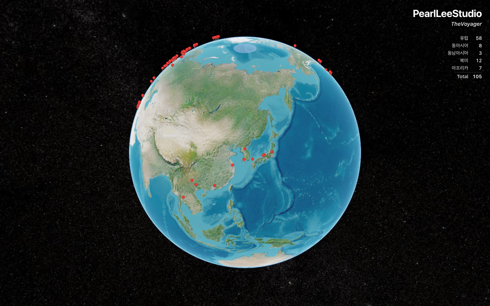
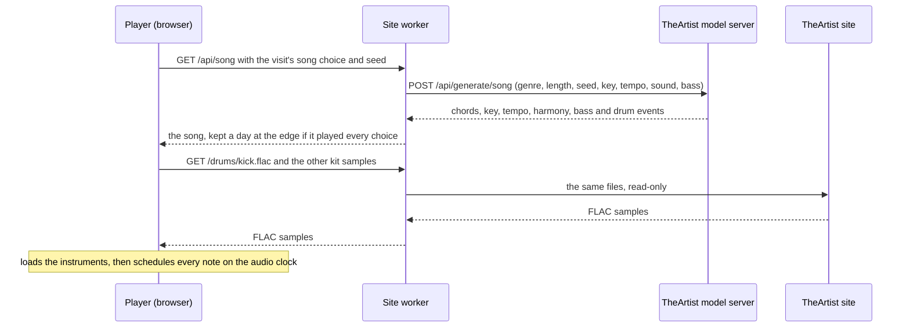

<h1 align="center">TheVoyager</h1>

<p align="center">
  <em>"What does this place sound like to <strong>you</strong>, on this day, with this memory?"</em><br>
  A decade of travel diaries as a playable map — every pin is a city, every visit has its own song.
</p>

<p align="center">
  
  <a href="https://github.com/PearlLeeStudio/TheArtist"></a>
  <a href="https://huggingface.co/PearlLeeStudio"></a>
  <a href="LICENSE"></a>
  
</p>

<p align="center">
  <a href="https://voyager.pearlleestudio.co"><strong>Open TheVoyager</strong></a> ·
  <a href="https://github.com/PearlLeeStudio/TheArtist">TheArtist music engine</a> ·
  <a href="#how-the-music-is-made">How the music is made</a>
</p>

<p align="center">
  
</p>

## Spin, open, listen

| Step | What you can do |
|---|---|
| Spin | Turn and zoom the 3D globe. Each city in the diary has one pin. A tally shows the cities per continent and the total number of visits. |
| Open | Click a pin to fly to the city and open its diary, with the dates of the visit and a photo slideshow. The button at the bottom of the panel expands it to show the journal text. A city visited more than once has a tab for each visit. |
| Listen | A black player in the look of TheArtist's Play panel plays the song of the visit you have open. While a song plays live, its screen shows the chord under the playhead, and the Rhythm and Drums windows light where the harmony, the bass and the drums strike in the bar that plays. |

<p align="center">
  
</p>

TheVoyager is a map-based memory–music piece. Ten years of the author's travel
diaries — 100+ visits across ~90 cities, posted as photo-and-text threads —
become a 3D globe of pins. The same city visited twice yields two different
songs: the **visit**, not the place, is the unit of memory.

It is a **single-person instrument**: it ingests the author's own Threads
travel diary — text and photographs — interprets each visit with a vision LLM,
and turns that interpretation into a song. Where TheArtist, the author's music
editor, lets a musician choose a song's key, tempo, instruments, rhythm and
drums, TheVoyager lets the LLM choose all of them for each visit. The pipeline is fitted to one
person's memory and one person's way of writing it down; it is not a
general-purpose service, and it plays only the author's archive (see
[Roadmap](#roadmap)). Every visit plays live: when it opens, TheArtist's model
server writes its song and the browser plays it (see
[Live playback](#live-playback)). Each visit also keeps a recording prepared
ahead of time, rendered in June 2026, which plays if the live song cannot be
written or loaded.

## Getting started

There is nothing to install. The piece itself is live at
[voyager.pearlleestudio.co](https://voyager.pearlleestudio.co): the full map,
every diary, every song. Spin the globe, click a pin, listen.

The public repository holds no application to build or run (see
[Repository layout](#repository-layout)). If you want a system you can
actually run, see **[TheArtist](https://github.com/PearlLeeStudio/TheArtist)**
— the music engine behind this work — which is published as a runnable demo
app.

## How the music is made

### The music engine is TheArtist

Every song in TheVoyager is built on a chord progression generated by
**TheArtist**, the author's separately published chord-generation engine — a
custom-trained Music Transformer with genre adapters (weights on
[HuggingFace](https://huggingface.co/PearlLeeStudio), code at
[PearlLeeStudio/TheArtist](https://github.com/PearlLeeStudio/TheArtist)).
The accompaniment and the audio of the prepared recordings are TheVoyager's
own; a live song is TheArtist's arrangement of the song the LLM chose.

The boundary is a design decision:

- **TheArtist writes the song.** TheVoyager asks TheArtist's song service
  (`POST /api/generate/song`) for a genre, a length and a seed, and for a
  live song also the key, tempo, harmony instrument, comping rhythm, drum
  pattern and bass; it sends nothing else about the visit. The answer holds the chord progression
  with its tempo and meter, and TheArtist's three-track arrangement: harmony,
  bass and drums. Since November 2026 the recordings' pipeline defaults to
  the model server that also serves TheArtist's editors, and the live player
  uses the same server.
- **The prepared recordings: TheVoyager realizes the accompaniment.** The
  recordings take **only the chord progression**, with its tempo and meter,
  not the accompaniment tracks that come with it. Genre-specific comping and
  drum patterns, a root-and-fifth bass line with approach notes, per-genre
  instruments, voice-leading voicings, humanization, and the final audio
  render are TheVoyager's own layer.
- **A live song: chosen whole by the LLM.** For each visit the reading LLM
  chose, among TheArtist's own options, the genre, the length, the key, the
  tempo, the harmony instrument, the comping rhythm, the drum pattern (or no
  drums) and the bass. TheArtist writes the chords in that key and plays its
  tracks with those choices, and the browser plays the result on the sampled
  instruments TheArtist's editor uses; the bass rhythm stays the genre's.
  The key, tempo and bass took effect on 11 November 2026, when the shared
  model server moved to TheArtist's build of 10 November; the player's screen
  shows the key and tempo actually played.

### Pipeline

```text
[Stage 1 — ingestion]
  Threads API → root post + reply chain → visit rows + photos

[Stage 2 — interpretation]
  visit (journal text + photos) → vision LLM
  → VisitInterpretation: a weighted shortlist from 13 genres
    + intensity / valence / density scalars + sub-style + reasoning
  → the whole live song, chosen from TheArtist's options: genre, length,
    key, tempo, harmony instrument, comping rhythm, drums, bass
  → cached as an inspectable, editable record — the curation surface

[Stage 3 — music]
  ├ prepared recording (June 2026): deterministic derive (seeded weighted
  │   draw of one genre, length from diary length) → TheArtist song service
  │   (genre, length, seed) → chord progression, tempo and meter
  │   → realization (comping / bass / drums; intensity sets note velocities,
  │     density sets chord thickness) → MIDI → sampler → WAV
  └ live song: the LLM's song choice and the visit's seed → TheArtist song
      service when the visit opens → harmony, bass and drum tracks
      → played in the browser
```

The genre vocabulary (shared with TheArtist):
`jazz · pop · rock · blues · bossa · classical · country · rnb_soul ·
hip_hop · electronic · funk · folk · gospel`

Across the current archive all 13 genres appear — the vision LLM reads
each memory differently enough that a decade of diaries spreads over the
full vocabulary.

### Live playback

When a visit with a music plan opens, the player asks the site for
`/api/song?genre=…&bars=…&seed=…&key=…&bpm=…&instrument=…&rhythm=…&drums=…&bass=…`.
The site's worker accepts only one of the 13 genres, 1 to 64 bars, a 32-bit
seed and, when given, one of TheArtist's 24 keys, a tempo from 40 to 220, one
of its 31 harmony instruments, one of its 13 comping rhythms, one of its 15
drum patterns or none, and one of its two basses; it posts exactly those
fields to the model server. The server writes the same song for the same
request on the same build, so the worker keeps an answer at the edge for a
day, but only one that played every choice asked for: an answer from a
server that ignored the key, tempo or bass is passed on and not kept. The browser
loads every instrument and drum sample before the first note, schedules the
notes a moment ahead on the audio clock, and, with the swing, shuffle and
country drum patterns, plays the off-beat eighths late, as TheArtist's editor
does. If the song cannot be written or loaded, the visit's recording plays
instead.



The music plan holds, per visit, the song the reading LLM chose and the
visit's seed; it is written from the cached interpretations without calling
a language model, and playback never calls one. The interpretations behind
the current plan were made in November 2026: a vision LLM read each visit's
diary and up to six of its photos on the visit's own terms, with no house
style to lean toward, and then, from the diary and that reading, chose the
whole song. A live song is not the
recording played again: the recording arranges chords written in June 2026
for the June reading's genre, the live song is TheArtist's arrangement of
chords written by the current server for the November reading's genre and
sound.

Sounds in the browser: FluidR3_GM soundfont by Frank Wen, via
midi-js-soundfonts by Benjamin Gleitzman (CC BY 3.0); e-piano samples by Greg
Sullivan (CC BY 3.0); Splendid Grand Piano samples; drums from "The
Aasimonster" drumkit, DrumGizmo.org (CC BY 4.0), served by TheArtist.

### Design notes

- **memory → controls → harmony → audio.** There is no direct
  memory-to-audio mapping. The middle is an explicit, human-readable
  symbolic control layer: the interpretation of every visit can be read,
  edited, and regenerated.
- **The visit is canonical.** Same city, different visit, different song.
  Same visit, same song — the live song's choice is stored per visit, the
  seed sent to TheArtist (and, for the recordings, the genre draw and the
  realization seed) derive from the visit ID, and TheArtist returns the same
  song for the same request on the same model and runtime.
- **Two realization-side personalization axes.** Two of the visit scalars are
  read by the realization of the prepared recordings and are not sent to
  TheArtist: intensity scales the note velocities of the comping, bass and
  drums, and density switches the chord voicings between three and four notes
  at a fixed threshold. The rendered file is peak-normalized, so intensity
  changes how hard notes are struck, not how loud the file is. In the
  recordings valence and sub-style are stored and do not affect the audio.
  A live song does not read the scalars as numbers; the visit's feel reaches
  it through the LLM's choice of key, tempo, instrument, rhythm, drums and
  bass.
- **Rule-based realization, deliberately.** The accompaniment realization
  is pattern-table based and stops short of learned arrangement — pushing
  that into TheArtist would break its identity as a chord generator. The
  tables are the author's tuning surface.

## Repository layout

The public repository,
[PearlLeeStudio/TheVoyager](https://github.com/PearlLeeStudio/TheVoyager),
holds:

| Path | Contents |
|---|---|
| `README.md`, `screenshot/` | The exhibit: this description and two views of the deployed piece |
| `LICENSE` | View-only license |
| `_worker.js`, `_routes.json`, `index.html` | Legacy deployment entry (see [Delivery architecture](#delivery-architecture)) |

It is a single-commit exhibit. Because TheVoyager is a single-person
instrument, the public repository documents the work rather than
distributing it:

- **No application source.** The implementation — Threads ingestion, vision-LLM
  interpretation, music derivation, accompaniment realization, audio
  render, and the map frontend — is private.
- **Deployment is separate from publication.** Application builds come from the
  private implementation; diary, photograph and audio archives are not copied
  into Git.
- **No credentials.** The deployment entry uses the public content host.

### Delivery architecture

The application source stays in a private repository. A separate private build
packages the browser application and Cesium runtime for Cloudflare Pages.
Travel diaries, photographs and prepared music remain on a separate content
host. Live songs come from TheArtist's model server through the site's worker,
and the drum samples of the live player from TheArtist's site. The browser
application and the content it displays are accessible through the website;
private source history, research and credentials are not distributed.

```text
Private app source → private build → Cloudflare Pages → voyager.pearlleestudio.co
                                            ├ travel archive + prepared audio
                                            ├ live songs: TheArtist's model server
                                            └ drum samples: TheArtist's site
TheArtist music service → Voyager arrangement/render → prepared audio
```

The private-build deployment is active. Public repository pushes do not deploy
the application. The legacy `_worker.js` remains a reference for the previous
forwarding deployment. `thevoyager.pages.dev` supplies the travel archive and
prepared audio. That content host must remain available and must
not redirect back to the custom domain. Public exhibit publication and app releases
are separate operations; a public frontend source release is not required.

The map implementation now preloads basic earth tiles and city data, shows pins
without waiting for diary data or a display timer, and redraws only when needed.
Screenshots show this deployed implementation.

## Roadmap

**Any user's posts.** The system is planned to generalize beyond the
author's archive: connect your own Threads account, and the map plays
*your* diary. The current parsing and interpretation layers are
deliberately fitted to one person's writing conventions, so
generalization — account connection, format-agnostic parsing, per-user
data — is its own engineering chapter: planned, not dated.

## License

**View-only.** © 2026 Jinju Lee (PearlLeeStudio). Published for viewing
and reference as a portfolio exhibit; no use, copy, modification, or
distribution rights are granted. See [LICENSE](LICENSE).

Created by [Jinju (Pearl) Lee](https://www.linkedin.com/in/pearlmedicilee/) ·
[PearlLeeStudio](https://github.com/PearlLeeStudio).
